# FYP 全流程工作流（P0–P8，2026-10-20）

> 本文取代 `docs/workflow-and-open-items.md` 第 1、5 节的粗粒度图：那张图只有 23 个节点，
> 没有负责人、证据和验收判据，回答不了"下一件事卡在谁身上"。本文把同一项目拆成
> **9 个阶段 / 89 个任务**，每个任务带负责人、状态、证据文件、验收判据和依赖。
> 旧文档第 3、4 节的确认表与任务表已并入本文第 6、7 节（**旧文档本身未修改**）。
>
> 配套交互清单：`meetings/2026-10-20/fyp-workflow.html`（勾选进度，首次打开按本文状态预勾）。
>
> 数据截止：2026-10-19 交接（`docs/handoff-2026-10-19.md`）。状态变化先改本文，再改 HTML。

## 1. 图例

| 记号 | 含义 |
| --- | --- |
| ✔ 已完成 | 有仓库内证据文件，可复现 |
| ⋯ 进行中 | 已开工但未达验收判据 |
| ○ 未开始 | 未开工，无阻碍或阻碍未定 |
| ⊘ 阻塞 | 未开工，且被具体的人或硬件卡住（见表内"负责人"与正文第 5 节）|
| 粗箭头 `==>` | 关键路径（决定最早完成时间的那条链）|
| 菱形 | 门禁（Gate），不通过不得进入下一阶段 |
| ★ | 关键路径上的任务 |

## 2. 总流程图

```mermaid
flowchart TB
    classDef done fill:#d4edda,stroke:#28a745,color:#14532d
    classDef doing fill:#fff3cd,stroke:#ffc107,color:#664d03
    classDef todo fill:#f1f3f5,stroke:#adb5bd,color:#343a40
    classDef blocked fill:#f8d7da,stroke:#dc3545,color:#842029
    classDef gate fill:#e2e3f5,stroke:#6f42c1,color:#3d2a75
    classDef crit stroke-width:3px,stroke:#b3005e,color:#111

    subgraph P0["P0 立项与需求（8）"]
        direction TB
        P0T1["P0-T1 需求与白板归档 ✔"]
        P0T2["P0-T2 二体式形态 ADR-001 ✔"]
        P0T3["P0-T3 两段链路拓扑 ADR-003/004 ✔"]
        P0T4["P0-T4 带宽与采样率 ADR-002 ✔"]
        P0T5["P0-T5 范围契约 必须/应该/不做 ✔"]
        P0T6["P0-T6 采购报销 SOP 归档 ✔"]
        P0T7["P0-T7 平台选型 ADR-006→017 ✔"]
        P0T8["P0-T8 里程碑与答辩日期 ○"]
        P0T1 --> P0T2 --> P0T3 --> P0T4 --> P0T7
        P0T2 --> P0T5
        P0T3 --> P0T5 --> P0T8
    end

    subgraph P1["P1 接口冻结（12）"]
        direction TB
        P1T1["P1-T1 AUD1 冻结+黄金向量 ✔"]
        P1T2["P1-T2 LKA1 冻结+黄金包 ✔"]
        P1T3["P1-T3 C/Node 双实现+模拟器 ✔"]
        P1T4["P1-T4 阶段0 基线 v0.2 ✔"]
        P1T5["P1-T5 吞吐/延迟目标 ✔"]
        P1T6["P1-T6 GATT profile 候选 v1 ✔"]
        P1T7["★P1-T7 GATT 双端确认冻结 ⊘队友"]
        P1T8["P1-T8 ATT MTU 实测 ⊘队友"]
        P1T9["★P1-T9 type=4 COMMAND 定夺 ⊘队友"]
        P1T10["P1-T10 射频/连接参数/IO ⊘队友"]
        P1T11["P1-T11 传感器/ADC/时钟 ⊘队友"]
        P1T12["P1-T12 阶段0 16 项全勾 ⊘队友"]
        P1T1 --> P1T2 --> P1T4
        P1T1 --> P1T3
        P1T2 --> P1T3
        P1T2 --> P1T5
        P1T4 --> P1T6 --> P1T7
        P1T7 --> P1T8
        P1T7 --> P1T9
        P1T7 --> P1T10
        P1T7 --> P1T11
        P1T8 --> P1T12
        P1T9 --> P1T12
        P1T10 --> P1T12
        P1T11 --> P1T12
    end

    G1{"G1 阶段 0 冻结<br/>16 项证据<br/>未通过"}

    subgraph P2["P2 主机数据通路（11）"]
        direction TB
        P2T1["P2-T1 纯 C 整数通路 ✔"]
        P2T2["P2-T2 8 组 ctest ✔"]
        P2T3["P2-T3 端到端+真实数据 0.84bpm ✔"]
        P2T4["P2-T4 心率检测器 C 移植 ✔"]
        P2T5["P2-T5 固件骨架 512KB/49.7% ✔"]
        P2T6["P2-T6 NimBLE central ✔"]
        P2T7["P2-T7 线程封装+心率接入 ✔"]
        P2T8["P2-T8 三套基线+CI+复现脚本 ✔"]
        P2T9["P2-T9 AI 调用点与 ai_stub ✔"]
        P2T10["P2-T10 真实 BLE 验证 ○"]
        P2T11["P2-T11 协议库接入两端 ○"]
        P1T2 --> P2T1 --> P2T2 --> P2T3
        P2T1 --> P2T4
        P2T1 --> P2T5 --> P2T6 --> P2T7
        P2T4 --> P2T7
        P2T2 --> P2T8
        P2T3 --> P2T8
        P2T7 --> P2T9
        G1 --> P2T10
        P2T6 --> P2T10 --> P2T11
    end

    subgraph P3["P3 数据工程（8）"]
        direction TB
        P3T1["P3-T1 CirCor 获取+官方校验 ✔"]
        P3T2["P3-T2 索引与可训练队列 ✔"]
        P3T3["P3-T3 冻结5折+指纹+守卫 ✔"]
        P3T4["P3-T4 注释掩码解析 ✔"]
        P3T5["P3-T5 窗口策略六格 ✔"]
        P3T6["P3-T6 特征管线 log-mel/MFCC ✔"]
        P3T7["P3-T7 派生 manifest ×2 ✔"]
        P3T8["P3-T8 合成 PCG+真值 ✔"]
        P3T1 --> P3T2 --> P3T3
        P3T3 --> P3T4 --> P3T5
        P3T3 --> P3T5
        P3T3 --> P3T6
        P3T2 --> P3T7
        P3T4 --> P3T8
    end

    subgraph P4["P4 模型与评估（12）"]
        direction TB
        P4T1["P4-T1 线性基线 0.789 ✔"]
        P4T2["P4-T2 MFCC 臂 0.801 ✔"]
        P4T3["P4-T3 小 CNN 0.848 ✔"]
        P4T4["P4-T4 三臂×两窗口六格 ✔"]
        P4T5["P4-T5 容量研究 TCN 0.929 ✔"]
        P4T6["P4-T6 三种子+线程归因 ✔"]
        P4T7["P4-T7 校准+工作点 W1 ✔"]
        P4T8["P4-T8 阈值重定并冻结 ○"]
        P4T9["P4-T9 S1/S2 评估器+检测器 ✔"]
        P4T10["P4-T10 S1/S2 验收 0.7975 ✔"]
        P4T11["P4-T11 心率精度评估 ✔"]
        P4T12["P4-T12 MVP 输出契约 ✔"]
        P3T5 --> P4T1
        P3T6 --> P4T1
        P4T1 --> P4T2
        P4T1 --> P4T3
        P4T2 --> P4T4
        P4T3 --> P4T4
        P4T3 --> P4T5 --> P4T6
        P4T4 --> P4T7
        P4T6 --> P4T8
        P4T7 --> P4T8
        P3T8 --> P4T9
        P4T9 --> P4T10
        P3T4 --> P4T10
        P4T9 --> P4T11
        P4T10 --> P4T12
        P4T11 --> P4T12
    end

    subgraph P5["P5 泛化与失败分析（7）"]
        direction TB
        P5T1["P5-T1 campaign 域偏移 ✔"]
        P5T2["P5-T2 outcome 探针 ✔"]
        P5T3["P5-T3 增益归因 杂音特异 ✔"]
        P5T4["P5-T4 校准不可迁移 ✔"]
        P5T5["P5-T5 S1/S2 失败结构 ✔"]
        P5T6["P5-T6 心率粗错分析 ✔"]
        P5T7["P5-T7 外部队列验证 ○"]
        P4T5 --> P5T1
        P3T7 --> P5T1
        P4T5 --> P5T2
        P3T7 --> P5T2
        P5T1 --> P5T3
        P5T2 --> P5T3
        P5T1 --> P5T4
        P4T7 --> P5T4
        P4T10 --> P5T5
        P4T11 --> P5T6
        P5T3 --> P5T7
    end

    subgraph P6["P6 部署格式（10）"]
        direction TB
        P6T1["P6-T1 旧配方 INT8 掉 0.0937 ✔"]
        P6T2["P6-T2 配方修正+扫描 ✔"]
        P6T3["P6-T3 五折复核 掉 0.0191 ✔"]
        P6T4["P6-T4 TCN INT8 掉 0.1433 ✔"]
        P6T5["P6-T5 去归一化导出+契约测试 ✔"]
        P6T6["P6-T6 板选型 N16R8 ADR-017 ✔"]
        P6T7["P6-T7 显示预算 行缓冲 10KB ✔"]
        P6T8["★P6-T8 ESP-DL/TFLM 转换 ○"]
        P6T9["P6-T9 板上 INT8 复测 ○"]
        P6T10["P6-T10 TCN 的 QAT 可选 ○"]
        P4T3 --> P6T1 --> P6T2 --> P6T3
        P6T2 --> P6T4
        P4T5 --> P6T4
        P4T3 --> P6T5
        P6T3 --> P6T6 --> P6T7
        P6T5 --> P6T8
        P6T8 --> P6T9
        P6T4 --> P6T10
    end

    G2{"G2 模型选型<br/>FP32 + INT8 双门槛<br/>已通过"}
    G3{"G3 部署格式<br/>能上板吗<br/>仅 PC 证据"}

    P6T3 --> G2
    P6T4 --> G2
    G2 --> P6T6
    P6T5 --> G3
    G3 --> P6T8

    subgraph P7["P7 上板（14）★关键路径"]
        direction TB
        P7T1["★P7-T1 采购预审批 ○"]
        P7T2["★P7-T2 下单 N16R8+屏 ○"]
        P7T3["★P7-T3 到货+首次烧录 ○"]
        P7T4["P7-T4 MTU/PHY/CCCD 记录 ○"]
        P7T5["P7-T5 5 分钟丢帧 ○"]
        P7T6["P7-T6 P95 延迟 ≤15ms ○"]
        P7T7["★P7-T7 控制通路 <100ms ○"]
        P7T8["P7-T8 绑定/解绑/重连 ○"]
        P7T9["P7-T9 Wi-Fi 共存+拥塞 ○"]
        P7T10["★P7-T10 显示驱动+UI ≥10fps ○"]
        P7T11["★P7-T11 AI 集成 <200ms ○"]
        P7T12["P7-T12 峰值堆+堆曲线 ○"]
        P7T13["P7-T13 信号注入频响 队友 ○"]
        P7T14["★P7-T14 上板 11 项总验收 ○"]
        P0T6 --> P7T1
        P6T6 --> P7T1
        P7T1 ==> P7T2 ==> P7T3 ==> P7T10 ==> P7T11 ==> P7T14
        G1 --> P7T4
        P7T3 --> P7T4
        P7T4 --> P7T5
        P7T4 --> P7T6
        P1T9 ==> P7T7
        P7T4 --> P7T7
        P7T4 --> P7T8
        P7T5 --> P7T9
        P6T7 --> P7T10
        P6T8 ==> P7T11
        P7T11 --> P7T12
        P7T5 --> P7T12
        P7T5 --> P7T13
        P7T6 --> P7T14
        P7T7 ==> P7T14
        P7T8 --> P7T14
        P7T9 --> P7T14
        P7T12 --> P7T14
        P7T13 --> P7T14
    end

    G4{"G4 是否上板通过<br/>11 项实测<br/>未开始"}

    P7T14 --> G4

    subgraph P8["P8 交付（7）"]
        direction TB
        P8T1["P8-T1 答辩 PPT 11 页 ⋯"]
        P8T2["P8-T2 决策对比页 ⋯"]
        P8T3["P8-T3 失败与边界页 ✔"]
        P8T4["P8-T4 答辩问答表 ✔"]
        P8T5["P8-T5 论文提纲 ○"]
        P8T6["★P8-T6 论文正文 ○"]
        P8T7["P8-T7 复现包/演示/归档 ○"]
        P4T4 --> P8T1
        P6T3 --> P8T1
        P8T1 --> P8T2
        P4T10 --> P8T3
        P4T11 --> P8T3
        P6T4 --> P8T3
        P8T3 --> P8T4 --> P8T5
        P8T5 --> P8T6
        P6T9 --> P8T6
        G4 ==> P8T6
        P8T6 --> P8T7
    end

    class P0T1,P0T2,P0T3,P0T4,P0T5,P0T6,P0T7 done
    class P0T8 todo
    class P1T1,P1T2,P1T3,P1T4,P1T5,P1T6 done
    class P1T7,P1T8,P1T9,P1T10,P1T11,P1T12 blocked
    class P2T1,P2T2,P2T3,P2T4,P2T5,P2T6,P2T7,P2T8,P2T9 done
    class P2T10,P2T11 todo
    class P3T1,P3T2,P3T3,P3T4,P3T5,P3T6,P3T7,P3T8 done
    class P4T1,P4T2,P4T3,P4T4,P4T5,P4T6,P4T7,P4T9,P4T10,P4T11,P4T12 done
    class P4T8 todo
    class P5T1,P5T2,P5T3,P5T4,P5T5,P5T6 done
    class P5T7 todo
    class P6T1,P6T2,P6T3,P6T4,P6T5,P6T6,P6T7 done
    class P6T8,P6T9,P6T10 todo
    class P7T1,P7T2,P7T3,P7T4,P7T5,P7T6,P7T7,P7T8,P7T9,P7T10,P7T11,P7T12,P7T13,P7T14 todo
    class P8T1,P8T2 doing
    class P8T3,P8T4 done
    class P8T5,P8T6,P8T7 todo
    class G1,G2,G3,G4 gate
    class P1T7,P1T9,P6T8,P7T1,P7T2,P7T3,P7T7,P7T10,P7T11,P7T14,P8T6 crit
```



## 3. 任务表

状态口径：**已完成**必须有仓库内证据文件；**阻塞**必须写明卡在谁身上；不确定的一律 `未开始` 并标"待确认"。

### P0 立项与需求（8 项）

| ID | 任务 | 负责人 | 状态 | 证据 | 验收判据 | 依赖 |
| --- | --- | --- | --- | --- | --- | --- |
| P0-T1 | 原始需求与导师白板归档 | 我 | 已完成 | `assets/fyp-original-requirements.jpg`、`assets/fyp-supervisor-whiteboard.jpg` | 两份原始材料入库，需求条目可逐条回溯 | — |
| P0-T2 | 产品形态对比与二体式决策 | 共同 | 已完成 | ADR-001；`docs/group-meeting-2026-10-06-decisions.md` §1 | 一体式/有线二体/无线二体三方案均有对比，组会确认二体 | P0-T1 |
| P0-T3 | 两段链路拓扑（A: BLE，B: Wi-Fi） | 共同 | 已完成 | ADR-003、ADR-004；`docs/connectivity-topology.md` | 两段链路的制式、角色、吞吐下限写入拓扑文档 | P0-T2 |
| P0-T4 | 信号带宽与采样率决策 | 我 | 已完成 | ADR-002；`docs/phase0-interface-freeze.md` §3 | 20–1000 Hz / 8 kHz 采集 / 4 kHz 推理三值冻结（实测见 P7-T13） | P0-T3 |
| P0-T5 | 范围契约（必须/应该/不做） | 我 | 已完成 | `docs/fyp-scope-and-sufficiency.md` §2 | 三类均有条目与证据出处；不做项含诊断、S1/S2 展示、树莓派、外移推理 | P0-T2 |
| P0-T6 | 采购与报销流程归档 | 我 | 已完成 | `docs/reimbursement/README.md` | 预审批→采购→协调员→财务四步、¥1500 额度、CA2 截止日可查 | — |
| P0-T7 | 主机平台架构选型（ADR-006→ADR-017） | 我 | 已完成 | ADR-006、ADR-017 | 4 个候选按 RAM/算力/BLE 集成度/成本对比，结论 S3 N16R8 | P0-T4 |
| P0-T8 | 里程碑与答辩日期确认（倒排计划） | 共同 | 未开始 | 待确认（仓库无日期记录；报销截止依赖 CA2 整体答辩首日，见 `docs/reimbursement/README.md`） | 中期/预答辩/CA2 日期与倒排里程碑写入仓库 | P0-T5 |

### P1 接口冻结（12 项）

| ID | 任务 | 负责人 | 状态 | 证据 | 验收判据 | 依赖 |
| --- | --- | --- | --- | --- | --- | --- |
| P1-T1 | AUD1 帧冻结 + 黄金向量 | 我 | 已完成 | `shared/include/audio_protocol.h`；`tests/test_audio_protocol.c`（golden frame，CRC `0x365E`） | 352 B 帧逐字节固定；header/CRC 黄金向量可复算 | P0-T4 |
| P1-T2 | LKA1 分包/重组冻结 + 黄金包 | 我 | 已完成 | `shared/include/link_a_protocol.h`；`tests/test_link_a_protocol.c`（golden packet） | 22 B 开销、222 B 分片；乱序/重复/丢片语义固定 | P1-T1 |
| P1-T3 | C/Node 双参考实现 + 零依赖模拟器 | 我 | 已完成 | `shared/src/*.c`；`tools/audio-sim/*`；`tests/node/*.test.mjs` | 两套实现对同一黄金包输出一致；`npm run sim:demo` 可跑 | P1-T1、P1-T2 |
| P1-T4 | 阶段 0 接口基线 v0.2 | 共同 | 已完成 | `docs/phase0-interface-freeze.md`（v0.2，§3–§7） | 采样率、帧长、端序、时间戳、序号语义成文 | P1-T1、P1-T2 |
| P1-T5 | 链路吞吐/延迟目标冻结 | 共同 | 已完成 | ADR-003；`docs/implementation-roadmap.md` | ≥320 kbps、P95 ≤15 ms 写进 ADR 与验收表，对 140.8 kbps 需求留 2× 余量 | P1-T2 |
| P1-T6 | GATT profile 候选 v1 | 我 | 已完成 | `docs/link-a-gatt-profile.md`；ADR-010 | 4 个方案对比；UUID、特征、CCCD 顺序、绑定与重连成文（状态仍为候选） | P1-T4 |
| P1-T7 | GATT profile 双端确认并冻结 | 共同 | 阻塞（队友） | `docs/link-a-gatt-profile.md` §10；`docs/implementation-roadmap.md` 未勾选 | 队友书面确认 §10 全部 8 条，状态由候选改冻结 | P1-T6 |
| P1-T8 | ATT MTU 实测值确认（247 / 158） | 队友 | 阻塞（队友） | 待确认；`firmware/main/ble_central.h` 现按 247 实现 | 实测值 + 模块型号入库；非 247 时重算分片数与缓冲 | P1-T7 |
| P1-T9 | `type=4 COMMAND`（START/STOP）定夺 | 共同 | 阻塞（队友） | `docs/link-a-gatt-profile.md` §5.1（候选向量）；`firmware/main/ble_central.c`（`START_FROZEN=0`） | 二选一书面定稿：升 LKA1 v1.1 或走独立 Control 帧；升版则补 C/Node 测试 | P1-T7 |
| P1-T10 | 射频能力 + 连接参数 + 配对 IO 确认 | 队友 | 阻塞（队友） | 待确认；`docs/link-a-gatt-profile.md` §3.2、§6 | 128-bit 服务、2 特征、2M PHY、DLE 251、Conn Param Update、Just Works 六项逐条有实测或 datasheet | P1-T7 |
| P1-T11 | 传感器 / 探头 MCU / ADC / 8 kHz 时钟选型 | 队友 | 阻塞（队友） | 待确认；`docs/phase0-interface-freeze.md` §8 | 型号、位数、参考电压、增益、抗混叠、时钟 ppm 全部落表 | P1-T7 |
| P1-T12 | 阶段 0 完成证据 16 项全勾（G1） | 共同 | 阻塞（队友） | `docs/phase0-interface-freeze.md` §8（16 项仍全未勾） | §8 全部勾选，且两段链路实测记录在案 | P1-T8、P1-T9、P1-T10、P1-T11 |

### P2 主机数据通路（11 项）

| ID | 任务 | 负责人 | 状态 | 证据 | 验收判据 | 依赖 |
| --- | --- | --- | --- | --- | --- | --- |
| P2-T1 | 纯 C 整数数据通路 | 我 | 已完成 | `shared/src/host_pipeline.c`；`shared/include/host_pipeline.h` D1–D7 | 重组/CRC/Q15 抽取/环形缓冲全程无动态分配、无浮点 | P1-T2 |
| P2-T2 | 8 组 ctest 覆盖数据通路 | 我 | 已完成 | `tests/test_host_pipeline.c`（乱序、重复、坏 CRC、丢片、会话隔离、环形回绕、抽取器响应、确定性） | 8 组全绿；抽取器 440 Hz 增益 >0.9、1900 Hz <0.1 | P2-T1 |
| P2-T3 | 端到端链路测试 + 真实数据一致性 | 我 | 已完成 | `tests/test_end_to_end_chain.c`（5 组合成 + 真实数据） | 真实数据最大差 0.84 bpm；丢包与会话隔离用例通过 | P2-T1、P2-T4 |
| P2-T4 | 心率检测器 C 移植 | 我 | 已完成 | `shared/src/hr_detector.c`；`tests/test_hr_detector.c`；ADR-014 补充 | 召回 97.6%、精度 96.4%、\|Δt\| 中位 0.05 ms | P2-T1 |
| P2-T5 | 固件骨架构建通过 | 我 | 已完成 | `firmware/`；ADR-016；`firmware/README.md` §2 | 镜像 512,399 B、DIRAM 49.7%（余 171,781 B）、`main/` 无警告 | P2-T1 |
| P2-T6 | NimBLE central 实现 | 我 | 已完成 | `firmware/main/ble_central.c` | MTU 先于 CCCD、单次 ATT 过程、重连 0.5/1/2/4 s 上限 30 s（空口未验，见 P7-T4） | P2-T5 |
| P2-T7 | 线程安全封装 + 心率接入固件 | 我 | 已完成 | `firmware/main/app_pipeline.c`、`app_main.c`；ADR-016 补充 | 单一 mutex、静态环；`HR ~<bpm>`/`HR --` 与窗口步长有 `_Static_assert` 绑定 | P2-T6、P2-T4 |
| P2-T8 | 三套测试基线 + CI + 一键复现 | 我 | 已完成 | `.github/workflows/ci.yml`；`scripts/reproduce.sh`；`docs/handoff-2026-10-19.md` §3 | 三套全绿（C 5 / Node 16 / Python 246）；`scripts/reproduce.sh --fast` 可复跑 | P2-T2、P2-T3 |
| P2-T9 | AI 调用点与占位契约 | 我 | 已完成 | `firmware/main/ai_stub.c`；`docs/mvp-output-contract.md` §4 | 明确返回 `NOT_IMPLEMENTED`、概率 −1，不伪造分数 | P2-T7 |
| P2-T10 | 真实 BLE 模块验证 MTU/吞吐/P95/丢帧 | 共同 | 未开始 | 待确认；`docs/implementation-roadmap.md` 未勾选 | `link-a-gatt-profile.md` §9 第 2/4/5 项有实测记录 | P2-T6、P1-T8、P7-T3 |
| P2-T11 | C 协议库接入探头与主机（替换模拟器） | 共同 | 未开始 | 待确认；`docs/implementation-roadmap.md` 未勾选 | 探头发出真实 LKA1 帧、主机重组成功；模拟器不再是唯一数据源 | P2-T10、P1-T12 |

### P3 数据工程（8 项）

| ID | 任务 | 负责人 | 状态 | 证据 | 验收判据 | 依赖 |
| --- | --- | --- | --- | --- | --- | --- |
| P3-T1 | CirCor 1.0.3 获取与官方校验 | 我 | 已完成 | `data/raw/circor`；`tools/ai/verify_circor.py`、`download_circor_parallel.mjs` | 942 人 / 3163 条；官方 SHA256 与 CRC 全部通过 | — |
| P3-T2 | 患者级索引与可训练队列 | 我 | 已完成 | `tools/ai/prepare_circor.py`；`data/processed/circor/{subjects,recordings}.csv` | 可训练队列 874 人 / 3007 条（阳性 179）；未知标签单独成列 | P3-T1 |
| P3-T3 | 患者级分层 5 折 + 冻结指纹 + 泄漏守卫 | 我 | 已完成 | `tools/ai/freeze_splits.py`、`hs_splits.py`；`data/processed/circor/splits-summary.json`（`1f212dea…`）；ADR-013 | 指纹可复算；缓存校验 fold/val_ratio/种子/指纹；无跨折患者 | P3-T2 |
| P3-T4 | 分割标注解析与注释掩码 | 我 | 已完成 | `tools/ai/hs_segments.py`；ADR-015；`evaluate_s1s2.py --annotation-mask` | 只统计标注区间；覆盖率与被丢弃检出数进入报告 | P3-T3 |
| P3-T5 | 窗口策略对照（全部 vs 标注窗口） | 我 | 已完成 | `data/reports/circor-cv-*/report.json`（六格） | 两策略同折同超参对比，"标注优先"结论可复现 | P3-T4 |
| P3-T6 | 特征管线（40 带 log-mel / MFCC+Δ） | 我 | 已完成 | `tools/ai/hs_features.py`、`hs_mfcc.py`；`tests/python/test_hs_features.py` | 2 s / 4 kHz 带限窗；特征形状与数值有单测 | P3-T3 |
| P3-T7 | 派生 manifest：outcome 与 campaign | 我 | 已完成 | `tools/ai/make_label_manifest.py`；`data/processed/circor-outcome/summary.json`（`71c0fd…`）；`data/processed/circor-campaign/summary.json`（`3fa1d8…`） | 两份派生集标签计数与指纹固定（486/456；695/179） | P3-T2 |
| P3-T8 | 合成 PCG 与同格式 S1/S2 真值 | 我 | 已完成 | `tools/ai/synthetic_pcg.py`；`tests/python/test_hs_s1s2.py` | 合成数据可生成，真值格式与 CirCor 一致 | P3-T4 |

### P4 模型与评估（12 项）

| ID | 任务 | 负责人 | 状态 | 证据 | 验收判据 | 依赖 |
| --- | --- | --- | --- | --- | --- | --- |
| P4-T1 | 线性基线（40 带 log-mel + LR） | 我 | 已完成 | `tools/ai/train_baseline.py`；`data/reports/circor-cv-logreg-annotated/report.json` | 患者级 AUROC 0.789 ± 0.031 | P3-T5、P3-T6 |
| P4-T2 | MFCC+Δ 第三臂 | 我 | 已完成 | `tools/ai/train_mfcc.py`；ADR-012；`data/reports/circor-cv-mfcc-annotated/report.json` | 0.801 ± 0.043；复用同折与同阈值规则 | P4-T1 |
| P4-T3 | 小 CNN（41,105 参数） | 我 | 已完成 | `tools/ai/hs_cnn.py`、`train_cnn.py` | 0.848 ± 0.051（pooled 0.814）；参数量 41,105 | P4-T1 |
| P4-T4 | 三臂 × 两窗口六格真实数据复核 | 我 | 已完成 | `data/reports/circor-cv-*/report.json`；`three-arm-summary.json` | 六格全部患者级 5 折；LR 两格与 ADR-007 逐位一致 | P4-T1、P4-T2、P4-T3 |
| P4-T5 | 容量研究（ResNet 463k / TCN 332k） | 我 | 已完成 | `tools/ai/large_model_experiment.py`；`data/reports/circor-large-model/report.md` | 同折同窗同超参，只改容量：0.848 / 0.897 / 0.929 | P4-T3 |
| P4-T6 | 三种子复现 + 线程数归因 | 我 | 已完成 | `data/reports/circor-seed-replication/REPORT.md`、`PRE-REGISTRATION.md`；ADR-007 补充 | 15/15 折对为正、区间不含 0；4 线程逐位复现（`pooled_delta=0.0`） | P4-T5 |
| P4-T7 | Platt 校准 + 工作点 W1 + bootstrap CI | 我 | 已完成 | `tools/ai/workpoint_analysis.py`；`data/reports/workpoint-summary.md`、`workpoint-cnn.json` | ECE 0.22–0.24 → 0.042；CNN 敏感度 0.777 / 特异度 0.797 | P4-T4 |
| P4-T8 | 阈值重定并冻结工作点 | 我 | 未开始 | `data/reports/workpoint-summary.md`（0.80 门槛差 0.003，2/5 折达标）；`meetings/2026-10-20/outline.md` 第 5 页 | 新阈值在冻结折上双指标 ≥0.80，或明确接受 0.797 并写进论文 | P4-T7、P4-T6 |
| P4-T9 | S1/S2 事件级评估器 + 确定性 DSP 检测器 | 我 | 已完成 | `tools/ai/hs_events.py`、`hs_s1s2.py`、`evaluate_s1s2.py`；ADR-015 | ±100 ms 容差、互换率、患者级聚合；合成数据 macro F1 0.827 | P3-T8 |
| P4-T10 | S1/S2 真实验收与三次改进 | 我 | 已完成 | `data/reports/s1s2-circor*.json`、`nested-fold*.json`、`s1s2-hrprior.json`；ADR-008/011 补充 | 嵌套 0.7975 ± 0.0210（<0.80）；>120 bpm 互换 0.273；结论如实记为未达标 | P4-T9、P3-T4 |
| P4-T11 | 心率精度评估（离线 + 设备条件） | 我 | 已完成 | `tools/ai/evaluate_heart_rate.py`；`data/reports/heart-rate-circor.json` | 中位 1.19 / MAE 6.79 / p95 44.2 / 13.5% 粗错；设备条件 MAE 8.14 | P4-T9 |
| P4-T12 | ADR-008 回退与 MVP 输出契约 | 我 | 已完成 | `docs/mvp-output-contract.md`；ADR-008 回退已激活 | 波形与杂音为权威、心率带 `~`、S1/S2 不展示；措辞与验收条款成文 | P4-T10、P4-T11 |

### P5 泛化与失败分析（7 项）

| ID | 任务 | 负责人 | 状态 | 证据 | 验收判据 | 依赖 |
| --- | --- | --- | --- | --- | --- | --- |
| P5-T1 | campaign 域偏移（CC2014↔CC2015） | 我 | 已完成 | `data/reports/circor-campaign-cv/{logreg,small,tcn}/report.json` | 三臂同 2 折：TCN 0.903 vs 小 CNN 0.773 | P4-T5、P3-T7 |
| P5-T2 | outcome 第二标签探针（942 人） | 我 | 已完成 | `data/reports/circor-outcome-942/report.md` | 三臂贴杂音天花板 0.650–0.662；TCN 0.672 | P4-T5、P3-T7 |
| P5-T3 | 增益归因（杂音特异，非通用容量/捷径） | 我 | 已完成 | `data/reports/circor-generalisation/report.md`；ADR-007 补充 | 同层 +0.005（不显著）、跨层 +0.065，与两个探针结论一致 | P5-T1、P5-T2 |
| P5-T4 | 跨中心校准不可迁移的量化 | 我 | 已完成 | `data/reports/workpoint-summary.md`；ADR-007 补充 | 沿用源中心阈值 BA 0.77 → 0.596，结论"设备必须重校准" | P5-T1、P4-T7 |
| P5-T5 | S1/S2 失败结构分析（高心率反相） | 我 | 已完成 | `data/reports/s1s2-circor-seq.json`；ADR-011 补充 | 139/516 条整段反相、>120 bpm 互换 0.273，失败被解释而非隐藏 | P4-T10 |
| P5-T6 | 心率粗错结构与两次改进失败 | 我 | 已完成 | `docs/mvp-output-contract.md` §3；`data/reports/heart-rate-circor.json` | 426 条粗错中 99 条为"每拍单事件"；两条改进路线均记为失败 | P4-T11 |
| P5-T7 | 外部队列验证（Heart Valve Regurgitation） | 我 | 未开始 | `docs/fyp-scope-and-sufficiency.md` §2.2（未开始）；`docs/handoff-2026-10-19.md` §5（主动推迟） | 标签映射方案先评审再下载；产出外部 AUROC 与 CI | P5-T3 |

### P6 部署格式（10 项）

| ID | 任务 | 负责人 | 状态 | 证据 | 验收判据 | 依赖 |
| --- | --- | --- | --- | --- | --- | --- |
| P6-T1 | 首轮 INT8 量化（旧配方） | 我 | 已完成 | `data/reports/int8-cv/`；ADR-007 补充 | 5 折平均掉点 0.0937、最差折 0.2598，判 FAIL 并记录 | P4-T3 |
| P6-T2 | 量化配方修正 + 5 变体扫描 | 我 | 已完成 | `data/reports/int8-cv-v2/summary.md`、`changes.diff.md`；`data/reports/int8-calibration-sweep/summary.md` | QInt8 对称 + per-channel + Percentile 99.99 + 200 随机窗；掉点 0.0191 | P6-T1 |
| P6-T3 | 五折 INT8 复核（最差折 0.0470、69,856 B） | 我 | 已完成 | `data/reports/int8-cv-v2/summary.json`、`fold0..4` | 5 折全部重算；1/5 折超 0.03 但 ≤0.05；体积 69,856 B | P6-T2 |
| P6-T4 | TCN INT8 失败（掉 0.1433 / 395,818 B） | 我 | 已完成 | `data/reports/tcn-int8/fold0.json`、`tcn-recipe-sweep.json` | 跨配方稳定失败（仅 fold 0，已注明）→ 否决 TCN 的 PTQ 路径 | P6-T2、P4-T5 |
| P6-T5 | 去归一化导出 + 契约测试 | 我 | 已完成 | `tools/ai/train_cnn.py`（`include_normalization=False`）；`tests/python/test_deployment_export.py`；ADR-018 | 图内无 Div/Sqrt/Sub；与完整模型 logit 差 4.1e-4（5 项测试固定） | P4-T3 |
| P6-T6 | 开发板选型（N16R8 + 320×240 ST7789） | 我 | 已完成 | ADR-017 | 4 候选对比 + 采购清单 + 失败判据与回退成文 | P6-T3 |
| P6-T7 | 显示内存方案 + IRAM 口径更正 | 我 | 已完成 | `docs/iram-and-display-budget.md` | 方案 B 行缓冲 10,240 B；DIRAM 余量 ≥60 KB 的验证方法成文 | P6-T6 |
| P6-T8 | ESP-DL / TFLite Micro 转换 | 我 | 未开始 | 待确认；`docs/handoff-2026-10-19.md` §6 缺陷 1 | 转换成功，且板上输出与 PC ONNX 一致（见 P7-T11） | P6-T5 |
| P6-T9 | 板上 INT8 RAM/时延/电流复测 | 我 | 未开始 | 待确认；`docs/implementation-roadmap.md` 未勾选 | 峰值堆、P95 单窗、平均电流三项均有板上数字 | P6-T8、P7-T3 |
| P6-T10 | TCN 的 QAT（可选，不在关键路径） | 我 | 未开始 | `docs/handoff-2026-10-19.md` §5；ADR-007 补充 | TCN INT8 掉点 ≤0.03 且体积可接受；否则维持小 CNN | P6-T4 |

### P7 上板（14 项，全部未开始）

| ID | 任务 | 负责人 | 状态 | 证据 | 验收判据 | 依赖 |
| --- | --- | --- | --- | --- | --- | --- |
| P7-T1 | 采购预审批（PI 邮件 + 311 表格） | 我 | 未开始 | `docs/reimbursement/README.md`（一页流程）；`docs/reimbursement/source/311-fyp-purchase-reimbursement-sop-redacted.pdf` | PI 同意邮件与申请表归档 | P0-T6、P6-T6 |
| P7-T2 | 下单 N16R8 + 2.8″ 320×240 SPI 屏 | 我 | 未开始 | ADR-017 采购清单 | 订单号、发票抬头与税号、实付金额齐备 | P7-T1 |
| P7-T3 | 到货验收与首次烧录启动 | 我 | 未开始 | 待确认；`firmware/README.md` §6 第 1 步 | `idf.py flash` 成功；boot banner 与 heap 数字入日志 | P7-T2 |
| P7-T4 | 记录 MTU/PHY/连接间隔/CCCD 顺序 | 共同 | 未开始 | 待确认；`docs/link-a-gatt-profile.md` §9 第 2/3 项 | 四项逐条有实测值，PHY 回退必须显式记录 | P7-T3、P1-T8 |
| P7-T5 | 5 分钟连续流丢帧率 | 共同 | 未开始 | 待确认；§9 第 4 项 | 吞吐 ≥320 kbps、完整帧丢失 ≤0.1%、无连续 3 帧丢失 | P7-T4、P2-T11 |
| P7-T6 | LKA1 附加延迟 P95 ≤15 ms | 共同 | 未开始 | 待确认；§9 第 5 项 | P95 ≤15 ms，最大 ≤30 ms | P7-T4 |
| P7-T7 | 控制通路 START/STOP 往返 <100 ms | 共同 | 未开始 | 待确认；§9 第 6 项；`ble_central.c` 的 `START_FROZEN=0` | 连发 100 次无丢，往返 <100 ms | P1-T9、P7-T4 |
| P7-T8 | 绑定 / 解绑 / 重连（session_id 递增） | 共同 | 未开始 | 待确认；§9 第 7/8/9 项 | 重启免配对；长按 5 s 解绑；断线后 session_id 递增且旧包不混入 | P7-T4 |
| P7-T9 | Wi-Fi 共存 + 拥塞上报 | 共同 | 未开始 | 待确认；§9 第 10/11 项 | 并发时第 4 项指标仍达标；拥塞时 `Status.error_code=2` | P7-T5 |
| P7-T10 | 显示驱动与 UI（波形+分数+心率 ≥10 fps） | 我 | 未开始 | `docs/iram-and-display-budget.md` §5；ADR-019；`firmware/main/display_stub.c` | 整屏 ≥10 fps 无明显撕裂；增量刷新只重画波形区 | P7-T3、P6-T7 |
| P7-T11 | AI 集成（ESP-DL / TFLM） | 我 | 未开始 | 待确认；`firmware/main/ai_stub.c`；`docs/workflow-and-open-items.md` §4 第 4 项 | 板上 logit 与 PC ONNX 差 <1e-2；单窗 <200 ms | P7-T10、P6-T8 |
| P7-T12 | 峰值堆 + 5 分钟堆曲线 | 我 | 未开始 | `docs/iram-and-display-budget.md` §5 第 4/5 项 | 峰值堆余量 ≥40 KB；5 分钟堆曲线无单调增长 | P7-T11、P7-T5 |
| P7-T13 | 信号注入频响（20/100/440/1 kHz） | 队友 | 未开始 | `docs/phase0-interface-freeze.md` §8；ADR-002 待验证 | 四频点频率与幅值在容差内，抗混叠效果有记录 | P7-T5 |
| P7-T14 | 上板 11 项联调总验收（G4） | 共同 | 未开始 | `docs/link-a-gatt-profile.md` §9（11 项）；`docs/phase0-interface-freeze.md` §8 | 11 项逐条有实测记录，不得用"已实现"替代实测 | P7-T4…P7-T13 |

### P8 交付（7 项）

| ID | 任务 | 负责人 | 状态 | 证据 | 验收判据 | 依赖 |
| --- | --- | --- | --- | --- | --- | --- |
| P8-T1 | 组会/答辩 PPT（11 页，每页一观点） | 我 | 进行中 | `meetings/2026-10-20/outline.md`（含每页证据表）；`meetings/2026-10-20/HANDOFF-to-deck-agent.md` | 11 页齐全、每页 1 观点、每个数字可追溯 | P4-T4、P6-T3 |
| P8-T2 | 决策对比页（重大决策各 ≥1 页） | 我 | 进行中 | `docs/engineering-decision-register.md`；`meetings/templates/engineering-decision-slides.md` | 候选/量化/风险/判据/回退五要素齐全，覆盖 ADR-001…019 | P8-T1 |
| P8-T3 | 失败与边界页 | 我 | 已完成 | `docs/fyp-scope-and-sufficiency.md` §5；`meetings/2026-10-20/outline.md` 第 10/11 页 | S1/S2、心率、量化、单数据集四项失败各有数字与出处 | P4-T10、P4-T11、P6-T4 |
| P8-T4 | 答辩问答表（问题→证据映射） | 我 | 已完成 | `docs/fyp-scope-and-sufficiency.md` §4 | 8 个高概率问题各有唯一证据出处 | P8-T3 |
| P8-T5 | 论文提纲与章节分工 | 我 | 未开始 | 待确认（仓库尚无论文提纲） | 章节-证据-图表三列大纲，含字数与截止日 | P8-T4 |
| P8-T6 | 论文正文（方法/结果/工程/失败与边界） | 我 | 未开始 | 待确认 | 四章成稿；每个数字带 FP32/INT8 与线程数标注 | P8-T5、P7-T14、P6-T9 |
| P8-T7 | 图表口径统一 + 复现包 + 演示与归档 | 我 | 未开始 | 待确认；`scripts/reproduce.sh` | 口径表（折均值 vs pooled）成文；tag + 依赖 pin 可复现；演示脚本含失败兜底 | P8-T6 |

## 4. 统计

| 阶段 | 任务数 | 已完成 | 进行中 | 未开始 | 阻塞 | 负责人分布 |
| --- | ---: | ---: | ---: | ---: | ---: | --- |
| P0 立项与需求 | 8 | 7 | 0 | 1 | 0 | 我 5 / 共同 3 |
| P1 接口冻结 | 12 | 6 | 0 | 0 | 6 | 我 4 / 共同 5 / 队友 3 |
| P2 主机数据通路 | 11 | 9 | 0 | 2 | 0 | 我 9 / 共同 2 |
| P3 数据工程 | 8 | 8 | 0 | 0 | 0 | 我 8 |
| P4 模型与评估 | 12 | 11 | 0 | 1 | 0 | 我 12 |
| P5 泛化与失败分析 | 7 | 6 | 0 | 1 | 0 | 我 7 |
| P6 部署格式 | 10 | 7 | 0 | 3 | 0 | 我 10 |
| P7 上板 | 14 | 0 | 0 | 14 | 0 | 我 6 / 共同 7 / 队友 1 |
| P8 交付 | 7 | 2 | 2 | 3 | 0 | 我 7 |
| **合计** | **89** | **56** | **2** | **25** | **6** | 我 68 / 共同 17 / 队友 4 |

## 5. 当前瓶颈与关键路径

### 5.1 三个真实卡点（2026-10-20）

| # | 卡点 | 卡住什么 | 解除动作 | 谁 |
| --- | --- | --- | --- | --- |
| B1 | **开发板未采购**（ADR-017 仍为"候选，未采购"） | P7 全部 14 项、P6-T9、P8-T6 的工程章 | P7-T1 预审批 → P7-T2 下单 → P7-T3 烧录 | 我 |
| B2 | **队友未确认 MTU 与 `type=4 COMMAND`**（GATT profile 仍"候选"） | P1-T7…T12、P2-T11、P7-T7/P7-T8 | 把 `docs/link-a-gatt-profile.md` §10 的 8 条发出去，要书面结论 | 队友 |
| B3 | **ESP-DL / TFLite Micro 未集成**（全部 INT8 数字来自 ONNX Runtime） | P7-T11、P7-T12、P6-T9；"部署格式"一节目前只有 PC 证据 | P6-T8 先转换，再按 P7-T11 的 <1e-2 / <200 ms 判据实测 | 我 |

> 与旧文档的差异：`docs/workflow-and-open-items.md` §5 把"显示内存方案"列为三个卡点之一。
> 该问题已由 `docs/iram-and-display-budget.md` 结案（方案 B 行缓冲 10,240 B，DIRAM 余 ≥160 KB），
> 因此本文把它替换为 B3（ESP-DL 集成）——这是目前唯一没有证据的部署环节。

### 5.2 关键路径

```text
P7-T1 预审批 ==> P7-T2 下单 ==> P7-T3 到货+烧录 ==> P7-T10 显示驱动
     ==> P7-T11 AI 集成 ==> P7-T14 上板 11 项 ==> P8-T6 论文工程章
```

两条支路汇入同一节点，任何一条断了 P7-T14 都过不了：

- **部署支路**：P6-T5 导出 → G3 → **P6-T8 ESP-DL 转换** → P7-T11；
- **协议支路**：P1-T6 → **P1-T7 GATT 冻结** → **P1-T9 COMMAND** → P7-T7 控制通路 → P7-T14。

关键路径上有 **7 个未完成节点**（P7-T1/T2/T3/T10/T11/T14、P8-T6），深度 7 跳。
非关键路径的可并行项：P4-T8 阈值重定、P5-T7 外部队列、P6-T10 TCN 的 QAT、P8-T1/T2 材料。

### 5.3 现在（不等硬件）就能推进的四件事

1. P6-T8：在 PC 上把"仅主体"模型转成 ESP-DL / TFLM 格式，先解决算子支持问题；
2. P7-T10：按 ADR-019 候选 A（内置 `esp_lcd` + 自绘、行缓冲）写显示骨架，可编译不可跑；
3. P7-T1：发采购预审批邮件，走 `docs/reimbursement/README.md` 的四步流程；
4. P4-T8：用现有 `probabilities.csv` 重定阈值，把 0.777/0.797 变成可写进论文的结论。

## 6. 与队友确认清单（并入旧文档 §3）

按阻塞程度排序；每条都对应上表的阻塞任务，答复即解锁。

| # | 确认项 | 对应任务 | 为什么卡我 | 需要的交付物 | 级别 |
| --- | --- | --- | --- | --- | --- |
| 1 | 实际 ATT MTU（247？158？） | P1-T8 | 不是 247 就要重算分片数、吞吐和缓冲 | 实测值 + 模块型号 | 🔴 高 |
| 2 | 是否加 `type=4 COMMAND`（START/STOP） | P1-T9 | 决定主机控制代码写一套还是两套 | 明确结论 | 🔴 高 |
| 3 | 模块射频能力（128-bit 服务、2 特征、2M PHY、DLE 251） | P1-T10 | 决定 GATT profile 能否落地 | datasheet 截图 / 实测 | 🔴 高 |
| 4 | congestion 行为与错误码 | P1-T10、P7-T9 | 决定 `Status.error_code=2` 能否上报 | 实测或厂商文档 | 🟡 中 |
| 5 | Connection Parameter Update 接受度（15 ms / latency 0） | P1-T10 | 延迟预算与功耗都依赖它 | 实测 | 🟡 中 |
| 6 | IO 能力（Just Works 还是 Passkey） | P1-T10 | 若只能 Just Works，安全按 ADR-010 回退 | 明确 | 🟡 中 |
| 7 | 传感器 / 探头 MCU / ADC 型号 | P1-T11 | 决定带宽、噪声底、电池与外壳 | 选型结论 | 🟡 中 |
| 8 | 8 kHz 采样时钟来源与精度（ppm） | P1-T11 | 时钟偏差会让两端缓冲漂移 | 晶振型号 / 实测 | 🟡 中 |
| 9 | 供电与续航目标 | P1-T11、P7-T12 | 决定电池与充电芯片 | 数字目标 | 🟢 低 |
| 10 | 探头固件能否对上黄金向量（CRC16、字节序） | P1-T12 | 联调第一道关，越早越好 | 一份 `probe.lka` 样例 | 🟢 低 |

## 7. 分工泳道（并入旧文档 §4）

| 泳道 | 任务 | 数量 |
| --- | --- | --- |
| **我（主机端 / 数据 / 论文）** | P0-T1/T4/T5/T6/T7；P1-T1/T2/T3/T6；P2-T1…T9；P3 全部 8 项；P4 全部 12 项；P5 全部 7 项；P6 全部 10 项；P7-T1/T2/T3/T10/T11/T12；P8 全部 7 项 | 68 |
| **队友（探头端）** | P1-T8、P1-T10、P1-T11、P7-T13 | 4 |
| **共同（需评审 / 联调）** | P0-T2/T3/T8；P1-T4/T5/T7/T9/T12；P2-T10/T11；P7-T4…T9、P7-T14 | 17 |

合计 68 + 4 + 17 = 89。

队友侧最短链：模块能力确认（P1-T10）→ GATT 冻结（P1-T7）→ COMMAND（P1-T9）→ 联调（P7-T7、P7-T14）。

## 8. 已否决（不纳入）

以下项在 ADR 或范围契约里已明确不做，**不进任务表**，也不应再被当作"遗漏"：

| 项 | 理由 | 记录 |
| --- | --- | --- |
| 疾病诊断（VSD/ASD/PFO） | CirCor 无病理标签；超出 MVP | `docs/fyp-scope-and-sufficiency.md` §2.3 |
| 杂音分级 / 位置 / 放射方向 | 数据集无此标注 | 同上 |
| S1/S2 在 MVP 中展示 | 嵌套 F1 0.7975 < 0.80，高心率互换 0.273 | ADR-008 回退、`docs/mvp-output-contract.md` |
| 换树莓派 | TCN 在 INT8 下不如小 CNN，精度理由消失 | ADR-006 补充、ADR-017 候选 C |
| 手机 / 服务器推理 | ADR-007 修订明确禁止外移推理 | ADR-007 约束修订 |
| 多位置融合 | 需要多位置同步采集协议 | `docs/fyp-scope-and-sufficiency.md` §2.3 |
| ESP32-P4 / STM32N6 | 无原生 BLE，算力不是本项目瓶颈 | ADR-017 候选 C/D |

## 9. 维护规则

1. 状态只在**证据文件出现后**才可改为已完成，改状态时同步填"证据"列；
2. 依赖变化先改本文第 2 节图与第 3 节表，再改 HTML（HTML 的复选框只记录"勾选进度"，
   不承担状态判定）；
3. 新增任务必须能指到 ADR、文档或报告，不接受"感觉该做"的条目；
4. 卡点变化时同步更新第 5.1 节，并在组会 PPT 上明示当前瓶颈。
