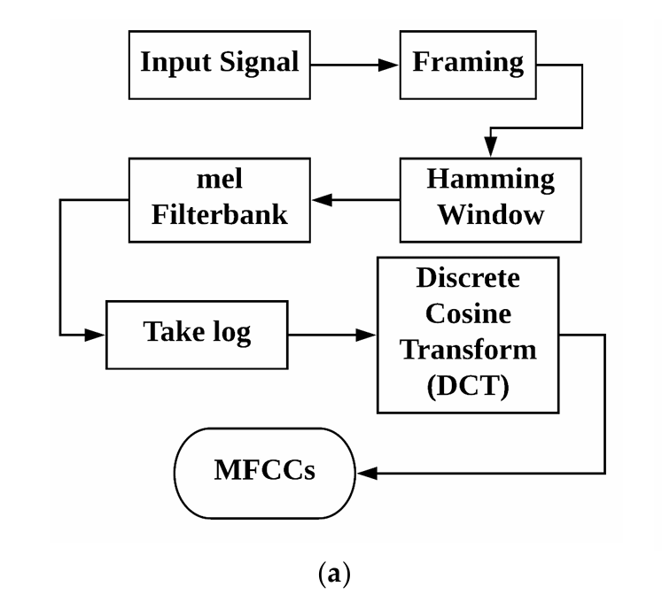

# 01 · Yaseen 2018 · 数据集与多特征

> 阅读深度：全文（2026-10-24），14 页，含 Table 1–6 与 Appendix A。
> 数字均标页码/表号；PDF 在 `docs/refs/01-yaseen-2018-applsci.pdf`。

## 引用

- 作者：Yaseen, Gui-Young Son, Soonil Kwon（原文就只写 "Yaseen"，**没有名/缩写**；通信作者 Soonil Kwon，世宗大学数字内容系）
- 标题：Classification of Heart Sound Signal Using Multiple Features
- 期刊/会议：Applied Sciences（Appl. Sci.）2018, 8(12), 2344
- 年份：2018（收稿 2018-10-10，接收 11-20，**发表 11-22**）
- DOI/链接：doi:10.3390/app8122344；<https://www.mdpi.com/2076-3417/8/12/2344>
- 全文位置：`docs/refs/01-yaseen-2018-applsci.pdf`（14 页，2.99 MB；MDPI 开放获取，**CC BY**）
- 备注：www.mdpi.com 对本机 403，PDF 是从 MDPI 的 CDN `mdpi-res.com` 直链取的；同一文件，`last-modified: 2018-11-22`。

## 数据

- 数据集：**作者自建**，不是公开数据集
- 规模：**1,000 个 .wav，5 类各 200**（Table 1：N 200、AS 200、MR 200、MS 200、MVP 200）
- 采样率：**8 kHz**、单声道（Appendix A：`data was sampled to 8000 Hz frequency rate and was converted to mono channel`）
- 时长：**论文没写秒数**；Appendix A 只说 `3 period heart sound signal`（3 个心动周期）。→ 综述写的 "3–5 s" 不是本文原话（见待查证）
- 来源：`books (Auscultation skills CD, Heart sound made easy) and websites (48 different websites ... including Washington, Texas, 3M, and Michigan)`
- 划分方式：**五折交叉验证**；"From dataset, 20% of sample data in each class was used for testing and eighty percent of sample data in each class for training"（p.11）
- 是否有患者 ID：**没有**。1,000 条来自 CD 与 48 个网站，无法追溯到人
- 清洗：`After conducting efficient cross check test, we excluded files having extreme noise`；编辑用 Cool Edit

## 方法

- 预处理：论文只列了 "noise removal" 这一步，**没给任何滤波参数**（无带通、无截止频率、无归一化）
- 特征 1：**MFCC 19 维**；帧长 **240 样本（30 ms @ 8 kHz）**、帧移 **80 样本（10 ms）**、Hamming 窗（p.5）
- 特征 2：**DWT**，3 级分解（Fig. 3b 的分解树），**特征向量 24 维**（p.6）；**小波类型没写**（见待查证）
- 融合：MFCC 19 + DWT 24 直接拼接
- 模型：三个分类器对比
  - **SVM**：二次核（quadratic），`C` 取 0.0003–0.0001，`gamma = log10(3)`（p.7）
  - **centroid displacement based KNN**：`k = 2.5`（p.11，原文如此）
  - **DNN**：3 个隐层 + 1 输出层，batch **100**，**2000** epochs（p.12）
- 训练细节：无学习率、无优化器描述（DNN 部分只给了上面三个数）

## 结果（原文数字）

| 表 | 特征 | KNN | SVM | DNN |
| --- | --- | --- | --- | --- |
| Table 2（基线）| MFCC | 72.2% | 87.2% | 82.3% |
| Table 3（调参后）| MFCC | 80.2% | 91.6% | 86.5% |
| Table 4 | DWT | 91.8% | 92.3% | 87.8% |
| **Table 5** | **MFCC + DWT** | **97.4%** | **97.9%** | **92.1%** |

- 平均 F1（Table 3–5）：融合特征下 KNN **99.2%**、SVM **99.7%**、DNN **98.3%**
- 敏感度 / 特异度（Table 6，融合特征）：KNN 97.6% / 98.8%；SVM **98.2% / 99.4%**；DNN 94.5% / 98.2%
- 原文结论句：`the overall maximum accuracy of 97.9% (F1 score of 99.7%) has been achieved using combine features of discrete wavelet transform and MFCCs, and training them via SVM classifier`
- 混淆矩阵：只有 **Figure 6 的图**，没有数值表 → 哪两类最易混**无法从文字读出**
- **内部矛盾三处**（原文自己不一致，不是我记错）：
  1. 摘要写 `up to 97%`，正文最高是 **97.9%**；
  2. 正文 p.12 写 `in case of DNN, the maximum accuracy of 89.3% has been achieved`，但 **Table 5 的 DNN 是 92.1%**；
  3. KNN 的 `k = 2.5` 不是整数。

## 我认为重要的点（原话/我的理解）

### 2026-10-24 你的转述（第一段）

> Background/ The classification of heart sound signal can be carried out by several machine learning classifiers available for ... 这段总结了这篇文章运用到的分类器，有SVM、DNN、KNN、CNN

**逐字保留，未改写。** 核对：**SVM、DNN、centroid-KNN 三个用到了；CNN 没有用，是明确被排除的**。

- 这段在 **Background（第 2 节），p.4**，原句紧接着给出实际使用的三个：`In this paper, our study shows that these classifiers (SVM and DNN also centroid displacement based KNN) have good performance for heart sound signal classification.`
- 下一句就是排除 CNN：`The performance of Convolutional Neural Network is optimized for image classification, so this method is not suitable for the feature set we used in this paper.`
- 再下一句是 RNN：`We also used Recurrent Neural Network in the pilot test, but our DNN method showed better results [10,11].` —— **只在 pilot 试过，没有进正式实验**。
- 交叉验证（p.5）：`To classify these features we used SVM, centroid displacement based KNN and DNN as classifiers.`
- 实验数量也印证是 3 个（p.8）：`the experiments we performed, can be categorized into nine types ... first 3 experiments using SVM ... second three experiments using DNN and last 3 experiments using centroid displacement based KNN`（3 分类器 × 3 特征组合 = 9）。
- 所以准确说法：**三种分类器 SVM / DNN / centroid-based KNN；CNN 与 RNN 不计入**。

### 2026-10-24 你的转述（第二段）

> 3.1. Mel Frequency Cepstral Coefficients (MFCCs)/In MFCCalgorithm, using Hamming window... 这段主要讲了MFCC的主要结构

**逐字保留，未改写。** 核对（p.5，3.1 节）：

原文给的流程（顺序照录）：`using Hamming window an audio signal is reshaped to smaller windows hence splitting of signal to frames is done. Using Fast Fourier Transform, spectrum is computed for each frame, using filter bank each spectrum is being weighted. Finally using Logarithm and Discrete Cosine Transform, the MFCC vector is computed [12,13].`

即：**分帧 → Hamming 窗 → 每帧 FFT → 滤波器组加权 → 对数 → DCT → MFCC 向量**。
（原文把"加窗"写在"分帧"前面，实际实现里是先分帧再加窗，不影响结论。）

*原文 Figure 3(a)，p.6；本文 CC BY 4.0，可引用。注意：**图里没有 FFT 这一步**，正文明确写了 "Using Fast Fourier Transform, spectrum is computed for each frame"——引用流程时以正文为准，图只作示意。*

- Mel 刻度公式（Equation 1）：`Mel(f) = 2595 log(1 + f/700)`（PDF 里分母的字形糊了，是 **700**）
- 参数（p.5 原句）：`we resampled each signal frequency to 8 KHz, the length of the each signal's feature extracted is 19 and the length of frame in each sample is 240 and the step size is 80`
  - 19 = 特征维数（19 个倒谱系数）
  - 帧长 240 样本 → **30 ms**（240/8000，我的换算，非原文）
  - 帧移 80 样本 → **10 ms**（80/8000，我的换算，非原文）
- **原文没给**（复现必需）：mel 滤波器个数、FFT 点数、预加重系数、是否含 Δ/ΔΔ、窗长与帧长的关系。
- 交叉核对：Appendix A 也提到 `data standardization after filtering`，但同样**没给滤波器参数**（与前面"没写带通"一致）。

### 2026-10-24 你的转述（第三段）

> DWT can be defined as a short wave which carries its energy and information 这一段主要介绍了DWT

**逐字保留，未改写。** 核对（p.6，3.2 节）：

- 定义句（原样）：`DWT can be defined as a short wave which carries its energy and information condensed in time. They are limited in space and possessing an average value approaching to zero.`
- 低频 / 高频的分工：`Low frequency components mostly contain maximum information part, and high frequency components convey quality.`
- 近似与细节（原文用词是 "estimation"，按惯例应为 approximation）：`The estimation is of the high-scale, low-frequency components of the signal and the Details are the low-scale, high-frequency components.`
- 分解树（Figure 3b 的标题：`Decomposition tree of wavelets (3rd level)`）：`at level one it has cA1, cD1 approximated and detailed components and at level two it has cA2 and cD2`；下采样是为了 `the absence of redundancy`。
- 特征维度只有一句：`In case of DWT the length of feature vector is 24.`
- 公式（Equation 2）：$DWT(x,y)=\int Z(t)\,\frac{1}{\sqrt{|2^x|}}\,\varphi\left(\frac{t-2^x y}{2^x}\right)dt$（PDF 里上下标糊了，这是我能辨认的形式，**符号以原文为准**）

**原文没给（复现必需）**：

- **小波族**（db4 / sym5 / coif5 / Haar…）——全文一次都没出现；
- 3 级分解后 4 个子带（cA3、cD3、cD2、cD1），但 **24 维是怎么来的**没解释；
- 边界延拓方式、是否归一化每个子带、用的是系数还是能量/熵统计量。

### 2026-10-24 你的转述（第四段）

> methodology主要讲了MFCC、DWT、SVM、DNN的基本概念

**逐字保留，未改写。** 核对（第 3 节）：

- 小节确实只有四个：**3.1 MFCC、3.2 DWT、3.3 SVM、3.4 DNN**（p.5–p.8）。
- **KNN 没有独立小节**：它只在 Background（p.4）被点名、在结果里用到（p.8：`we choose the value of k = 2.5`）。所以"方法章节"严格说是 3 个分类器有正文、KNN 没有。
- 第 3 节开头还有一段**流水线**：`acquisition of heart sound signal, noise removal, sampling the PCG signal at a specific frequency rate, feature extraction, training and classification`（Figure 2 给了 SVM / DNN 两条流程图），这一段不属于"基本概念"，是它的流程设计。
- 内容配比（客观描述）：3.1/3.2 讲特征怎么算；3.3 讲 SVM 原理并给出**超参**（二次核、`C` 0.0003–0.0001、`gamma = log10(3)`）；3.4 讲 DNN 原理并给出**结构**（`batch size equal to 100, three hidden layers and one output layer and 2000 epochs`，p.8）。
- 所以这篇的"方法"= **2 个特征 + 3 个分类器**，其中 KNN 只有一句话、SVM/DNN 有一节，**没有验证集、没有早停、没有超参搜索过程**（`C`/`gamma` 只给了最终取值）。

### 2026-10-24 你读完全文的总结

> 这篇论文的outcome就是使用MFCC和DWT两个特征最好了，分类器可能根据数据集的不同有不同效果。

**逐字保留，未改写。** 逐句核对：

**前半句：成立（限于本文这一份数据）。** 三个分类器在三组特征下，融合都最高：

| 分类器 | MFCC（Table 3）| DWT（Table 4）| **MFCC+DWT（Table 5）** |
| --- | --- | --- | --- |
| KNN | 80.2% | 91.8% | **97.4%** |
| SVM | 91.6% | 92.3% | **97.9%** |
| DNN | 86.5% | 87.8% | **92.1%** |

原文自己的结论句也是这个意思：`the overall maximum accuracy of 97.9% ... using combine features of discrete wavelet transform and MFCCs, and training them via SVM classifier`。

**后半句：本文无法支持。** 它只有**一份自建数据集**，**没有任何跨数据集实验**。本文能支持的是"在这份数据上 SVM 97.9 > KNN 97.4 > DNN 92.1"；作者对 DNN 较差的解释是数据量：`we have very limited amount of data available ... DNN requires thousands of files and features`（p.11），**不是"数据集不同"**。

- 若要在论文里写"分类器效果依数据集而异"，需要另找**跨数据集**证据。04 那种"不同数据集上主流架构不同"只是不同研究的并列，**不能直接横比**（数据、划分、指标都不同）。
- 另外：全文**没有标准差、没有 ±、没有置信区间、没有显著性检验**（我搜过 `standard deviation`/`±`/`confidence`/`significan`/`p-value`，零命中）。所以 **97.9% 与 97.4% 的差距不能声称"显著更好"**。

## 与我的 FYP 的关系

- 可借鉴：
  1. **这是 A1 臂的直接对标**：我们的 A1 是 MFCC+Δ+ΔΔ + LR/SVM；这篇是 MFCC(19) + DWT(24) + SVM，融合后 97.9%。我们做 A1 时可以把它当"同数据集、同特征族"的参照点。
  2. 它的**分帧参数**（30 ms / 10 ms / Hamming）与我们计划里的 25 ms / 10 ms 几乎一致，说明这套参数在心音上是常规选择（但**不能**说"引自本文"——本文没论证为什么选这组）。
  3. 数据集细节（1,000 / 5×200 / 8 kHz / 来源）= 我们本地实测的独立确认。
- 可改进（作者的局限）：
  - **五折交叉验证按类别分层随机**，没有按来源（CD vs 网站）或录音分组 → 与我们 ADR-020 的"同一录音不跨折"要求相比更松；
  - **只报总体 accuracy/F1/sens/spec**，没有每类 F1 数值，混淆矩阵只有图；
  - **没有外部验证**，也没有和任何已发表方法对比；
  - DNN 只有 3 隐层 2000 epochs 却比 SVM 差，作者归因于"数据太少"——这个归因没有实验支撑；
  - 特征维度、小波类型等关键参数缺失，**不可完全复现**。
- 不能用的部分：
  - **不能说"该数据集时长 3–5 s"**——本文没写秒数，只写 "3 period"；
  - 不能把 92.1% 当成这篇的最好成绩（那是 DNN 行；最好 97.9%）；
  - 不能引它证明"MFCC+DWT 优于深度学习"——它压根没做端到端模型；
  - **不能把它当作"杂音检测（二分类）"的引用**：Table 2–5 全部是五分类实验，摘要里的 "two main categories" 只是背景陈述，全文没有正常/异常的二分类结果。

## 待查证

- **小波类型**：正文只说 3 级分解，没写 db/sym/coif 哪种；要复现必须补。
- **DWT 的 24 维构成**：3 级分解只有 4 个子带，24 维从哪来原文没写（4 子带 × 6 个统计量？这只是我的**推测**，未经证实）；要复现必须自己定。
- "3 period" 是否指"3 个心动周期"（而不是 3 秒）——若如此，1,000 条的长度本应随心率变化，与本地实测 1.16–3.99 s 的分布是否吻合需另核。
- 89.3% vs Table 5 的 92.1%：哪个是 DNN 的真实结果？（可能是不同实验轮次）
- 第一作者的姓名缺失（MDPI 页面只写 "Yaseen"）：参考文献格式该怎么写？建议查 MDPI 页面的作者信息或 Scopus。
- Figure 6 的混淆矩阵是图，若要引用"哪两类最易混"必须自己从图里读或复现。
- **对 04 号笔记的修正**：Zhao 2024 写 "Yaseen et al. ... DNN ... 92.1%"，**数字本身对**（Table 5 的 DNN 行），但它把这篇的**最好成绩**说成了 92.1%，实际最好 97.9%（SVM）。引用时要区分。
