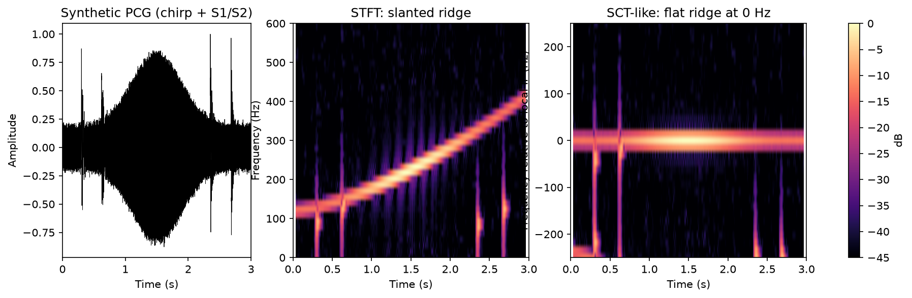

# 11 · Ghosh 2020 · SCT + 核稀疏网络

> 阅读深度：全文（2026-10-24）；**2026-10-26 用你提供的 PDF 逐条复核**。
> PDF：`docs/refs/11-ghosh-2020-bmri.pdf`（16 页）。数字均标表号/节名。

## 引用

- 作者：S. K. Ghosh, R. Ponnalagu, R. Tripathy, U. R. Acharya
- 标题：Deep Layer Kernel Sparse Representation Network for the Detection of Heart Valve Ailments from the Time-Frequency Representation of PCG Recordings
- 期刊/会议：BioMed Research International, 2020, Article ID 8843963
- 年份：2020
- DOI/链接：doi:10.1155/2020/8843963；PMC7769642
- 全文位置：`docs/refs/11-ghosh-2020-bmri-fulltext.xml`

## 数据

- **主数据集：Yaseen 的 1,000 条**（5 类各 200，8 kHz），文中给的是 GitHub 链接 [44]
- 预处理：**降采到 4 kHz** → Butterworth **25–900 Hz** 带通 → 按**最大幅度**归一化
- **外部验证 1：MHSMD**（Michigan 心音与杂音库），44.1 kHz → 4 kHz，含 N/AS/MS/MR/MVP
- **外部验证 2：自录 15 条**（15 人，12 男 3 女，27±5 岁，Thinklabs 听诊器，4 kHz）
- 划分：**hold-out 60%/10%/30%（5 次随机重复）** + **10 折交叉验证**
- 患者 ID：Yaseen 无；自录 15 条有受试者（但每人均为正常）

## 方法

- 特征：**SCT（spline-kernel chirplet transform）** 时频矩阵 → 在频带上算三类非线性特征 **LN / SEN / PEN**（L1 范数、谱熵、排列熵），共 **1,200 维**
- 模型：**DLKSRN** = 输入层 → **ELM-自编码器隐层 1（800 神经元）** → **ELM-AE 隐层 2（600）** → **KSRC（核稀疏表示分类）**
  - KSRC：映射到高维核空间 → 降维（随机投影/KPCA/KLDA）→ L1 稀疏系数 → 按类残差最小分类
  - 对照分类器：KSRC、随机森林（20 棵树/深度 15）、KNN（k=3，欧氏距离）
- 训练：ELM-AE 用闭式解（Eq. 9），**不是梯度下降**；KSRC 无需"训练"

## 结果（原文数字）

| 设置 | 结果 |
| --- | --- |
| **Yaseen，10 折 CV** | DLKSRN **99.24% ± 0.74**；KSRC 98.90%；KNN 97.12%；RF 96.12% |
| Yaseen，hold-out（5 次） | 平均 **99.23%**（结论节） |
| **MHSMD（外部）** | **96.79%**，每类敏感度/特异度 >94% |
| 自录 15 条（外部） | **15 条全部判为 N**（训练集来自公开库）|

- 每类指标（10 折）：MS 精确率 97.65±3.27、敏感度 99.50±1.58；AS 敏感度 99.00±2.10；MVP 精确率 98.06±2.49、敏感度 98.50±2.41；N 与 MR 均高于 99%
- 混淆矩阵：Figures 6–7（图，无数值表）
- 对比（Table 6，原文照录）：

| 文献 | 特征 | 分类器 | 类别 | 准确率 |
| --- | --- | --- | --- | --- |
| Maglogiannis [77] | 形态学特征（S1/S2 峰值等）| SVM | N, MS, MR | 91.23% |
| Uğuz [86] | 小波熵 | ANFIS | N, PS, MS | 98.33% |
| Safara [76] | 多级基选择小波（MLBS）| SVM | N, AS, MR, AR | 97.56% |
| Zheng [78] | 熵 + 能量分数 | SVM | N, TI, PS, MI, MS | 97.17% |
| **Yaseen [44]（=01）** | **小波 + MFCC** | SVM | **N, AS, MS, MR, MVP** | **97.90%** |
| Ghosh [36] | SST 幅值与相位 | RF | N, AS, MS, MR | 95.13% |
| Ghosh [13] | chirplet 变换 | 多类复合分类器 | HC, AS, MS, MR | 98.33% |
| Oh [79] | WaveNet | DNN | N, MS, MR, AS, MVP | 98.20% |
| **本文** | **SCT 时频 + LN/SEN/PEN** | **DLKSRN** | **N, MS, MR, AS, MVP** | **99.24%** |

  - ⚠️ **只有 [44]、[79] 和本文是完整的"N + 4 种 VHD"五类**；其余四行缺 MVP 或缺某些病（[78] 甚至是 TI/PS/MI 另一套病种）。**不同类别集合的准确率不能横比**，这张表只能当"同数据集上都有谁"的索引。
  - 原文还强调自己比 [13]（HC/AS/MS/MR）**多分了 MVP**，因此"同样高的准确率更难"——这个论点成立，但只对 [13] 那一行有效。

## 第 2 节（方法）解读（2026-10-26 应你要求）

这一节其实只有三个动作：**把信号变成时频图（2.2）→ 从图里提 1,200 维特征 → 用两层 ELM 自编码器 + 核稀疏分类（2.3）**。2.1 只是前处理。

### 2.1 前处理：为什么是这三步

| 步骤 | 做法 | 目的 |
| --- | --- | --- |
| 降采 | 8 kHz → **4 kHz** | 心音主要能量在 900 Hz 以下，4 kHz 已够（奈奎斯特 2 kHz），省一半计算 |
| 带通 | Butterworth **25–900 Hz** | 去基线漂移（<25 Hz）与高频噪声 |
| 归一化 | 除以**最大绝对值** | 消掉录音音量差异（注意：是峰值归一化，不是 z-score）|

### 2.2 SCT：普通 STFT 不够用的地方

**先看 STFT 的问题**：STFT 假设"一个窗内的频率不变"。但杂音是**频率随时间变化**的（chirp 型），窗一长，能量就糊在时频面上。

**chirplet 变换（CT）的补救**：在窗内再乘一个"频率旋转"因子，相当于假设窗内频率**线性变化**（有个斜率，叫 chirp rate），把斜的能量"掰直"后再做 FFT，时频脊线就变细。

**SCT（样条核 chirplet）再进一步**：不假设整段只有一个斜率，而是把时间轴切成若干段，**每段用一个低阶多项式（样条）描述该段的瞬时频率**，并强制段与段之间连续（Eq. 6 的 $\gamma_i-\gamma_{i+1}=\sum_l q_{i+1}^l(n-n_i)^l$，初值 $\gamma_1=0$）。

对应到公式：

- Eq. 2：$T(\tilde n,k)=\sum_n \bar x(n)\,w_\sigma(n-\tilde n)\,e^{-j2\pi nk/N}$，$\bar x(n)=x(n)\cdot\Psi_R\cdot\Psi_S$——就是"先修正、再加窗、再 FFT"；
- $\Psi_R$（Eq. 4）：频率**旋转**（按局部多项式把频率轴掰一下）；
- $\Psi_S$（Eq. 5）：频率**平移**（把中心频率挪到该段的位置）；
- $w_\sigma$（Eq. 3）：高斯窗。

**一句话**：SCT = STFT + "分段多项式瞬时频率"的先验，让杂音的时频脊更锐、能量更集中。

*图：自制演示（`assets/11-ghosh-stft-vs-sct.py`，numpy + matplotlib）。左：合成信号（120→420 Hz 上扫 chirp 当杂音，另加两对 S1/S2 爆发与噪声）。中：STFT，杂音脊线是一条**斜线**，能量分散在整条斜带上。右：用已知 chirp 频率解调后再做 STFT，脊线**塌缩成 0 Hz 附近的一条水平亮线**——这就是 SCT 想要的效果。*

*⚠️ 该演示直接用**已知**的 chirp 频率，不是论文那样用样条拟合估计 IF，只用于说明原理，不能当复现结果。*

### 2.3 DLKSRN：两层 ELM 自编码器 + 核稀疏分类

**(a) 为什么要 ELM 自编码器**：数据只有 1,000 条，用反向传播训深层网络容易过拟合，而且慢。ELM-AE 的权重有**闭式解**（Eq. 9）：

$$W_i=\left(H_i^{\mathsf T}H_i+\frac{I}{\gamma}\right)^{-1}H_i^{\mathsf T}\tilde Z$$

也就是"岭回归式"的一次矩阵运算，不用迭代。两层（800、600 个神经元）串起来得到新特征：

$$Z^*=f\big(f(W_1Z)\,W_2\big)$$

**(b) 为什么后面接 KSRC**：KSRC 是"稀疏表示分类"的核版本，**几乎不用训练**。四步：

1. 用核函数把特征映到高维（$\Psi$）；
2. 降维（$A=\Psi S$，$S$ 来自随机投影 / KPCA / KLDA）——因为核空间维度可能比样本数还大；
3. 解 **L1 最小化**求稀疏系数 $\gamma$（Eq. 11、15）；
4. 对每个类算**残差**（Eq. 16），取残差最小的类（Eq. 18）。

直观理解：**"用训练样本的稀疏组合去重建测试样本，哪一类能重建得最像，就判哪一类"**。

### 2.4 1,200 维特征从哪来

SCT 得到时频矩阵后，在**每个频带上**算三种非线性量：

- **LN**（L1 范数）：该频带的能量强度；
- **SEN**（谱熵）：该频带能量分布的混乱程度；
- **PEN**（排列熵）：该频带时间序列的复杂性。

三类 × 若干频带 = **1,200 维**（原文没给三类各多少维）。

### 2.5 这套方法的代价（给我们看的）

- 1,200 维 + 800/600 隐层 + 核矩阵 + L1 优化 → **不是端侧能跑的规模**；
- 但 **LN/SEN/PEN 本身很便宜**，如果只取其中一小部分（比如每类 8 维），是可以考虑搬到 A1 的传统特征臂里的。

## 我认为重要的点（原话/我的理解）

### 2026-10-26 你的理解

> 这篇文我的理解是：它使用了SCT的特征提取（这是我之前没有遇到过的），提取了LN、SEN、PEN作为特征，放入了DLKSRN分类器，这个分类器不是之前提到过得卷积神经网络，是一种固定参数的模型不需要训练。

**逐字保留，未改写。** 三处对、一处要修正：

- ✅ **SCT 特征提取**——确实是这篇的核心，而且不在 01/03/04 的方法清单里。
- ✅ **LN / SEN / PEN**——三个非线性量，共 1,200 维。
- ✅ **DLKSRN 不是 CNN**——它是"ELM 自编码器 + 核稀疏表示"，与卷积无关。
- ❌ **"固定参数、不需要训练"不准确**，要拆成两段看：

| 部分 | 是否有参数 | 怎么来的 |
| --- | --- | --- |
| 两层 ELM 自编码器（800、600）| **有，而且依赖训练数据** | 输入权重随机给定；输出权重用**闭式解**算：$W=(H^{\mathsf T}H+I/\gamma)^{-1}H^{\mathsf T}\tilde Z$（Eq. 9）|
| KSRC（分类层）| **没有训练参数** | 把训练样本存下来；测试时解 L1、按类残差最小分类（Eq. 11–18）|

所以准确说法是：**"不用反向传播、不用迭代训练"**（训练 = 解一次线性方程 + 存样本），而不是"参数固定"。

**代价在推理端**：KSRC 每来一个测试样本都要解一次 L1 优化，计算量随训练样本数增长——这是它"节省训练"换来的账。对我们端侧部署来说，这一条比"要不要训练"更关键。

- **（你还没有转述这篇的原话。）** 你转述时我逐字记在这里，不改写。

## 与我的 FYP 的关系

- 可借鉴：
  1. **外部验证的做法**：同一方法在 Yaseen 上 99.24%、在 MHSMD 上 96.79%——这是 04 里"同数据集高分 ≠ 泛化"的又一个具体例子（和 Alkhodari 99.32→87.31 同构）。
  2. **25–900 Hz 带通 + 最大幅度归一化**，与我们 20–1000 Hz 接近，可作为带宽选择的旁证（但不是一手依据）。
  3. **谱熵/排列熵**这类非线性特征，可以作为 A1 之外的传统特征补充臂。
- 可改进 / 需要注意：
  - **自录 15 条全部判为 N**，作者称之为"验证有效性"——但全部是正常样本，**证明不了能识别病变**；
  - 1,200 维特征 + 800/600 隐层，**参数量与计算量都不小**，与"端侧轻量"无关；
  - 10 折 CV 与 hold-out 都做了，比 01/03 规范，但**仍无患者级分组**。
  - **用测试集选超参**：原文写 "parameters ... are selected based on the maximum accuracy values in the **validation and test sets**"（Table 4 同时给 val 97.80 与 test 99.23）→ 99.23% 是**乐观偏倚**的结果。
- 不能用的部分：
  - **不能引"96.79%"来说明它在 Yaseen 上的水平**——96.79 是 MHSMD 的结果；Yaseen 上是 99.24%。04 综述把这两个数字混了（见下）。
- **对 04 的修正**：`04-Zhao-2024` 的 VHD 小节写 "Ghosh et al. [90] ... 96.79%"，实际 96.79 是 **MHSMD**；Yaseen 上是 99.24%。引用时必须分开写。

## PDF 复核记录（2026-10-26）

用 `docs/refs/11-ghosh-2020-bmri.pdf` 逐条核对，**全部一致**：

| 项 | 笔记值 | PDF |
| --- | --- | --- |
| 10 折 overall accuracy | 99.24% ± 0.74 | 99.24%，与 KSRC 98.90 / KNN 97.12 / RF 96.12 的对比句一致 |
| MHSMD 外部验证 | 96.79% | 96.79%，且原文写明"每类敏感度/特异度 >94%" |
| 特征维度 | 1,200 | 1,200 |
| 隐层神经元 | 800 / 600 | 800 and 600 |
| hold-out 比例 | 60/10/30 | 60%, 10%, 30% |
| 自录 15 条 | 全部判为 N | "predicted all 15 ... as normal class" |

→ 唯一需要强调的是：**96.79% 属于 MHSMD，99.24% 属于 Yaseen**，两者不能混。

## 待查证

- 1,200 维 = LN/SEN/PEN 各 400？原文只说 1,200 与"15 个代表特征"，没给拆分方式。
- KSRC 用的核函数与降维方法（随机投影/KPCA/KLDA 三选一）原文未明确指定哪一种。
- 自录 15 条的录音是否真的全为正常？原文写 "15 recorded PCG signals ... predicted all 15 as normal"，与"从 15 名受试者采集"一致，但没有说明是否含患者。
