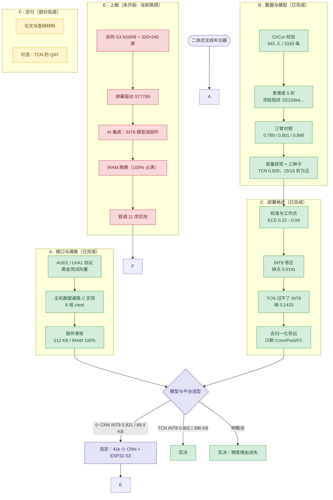
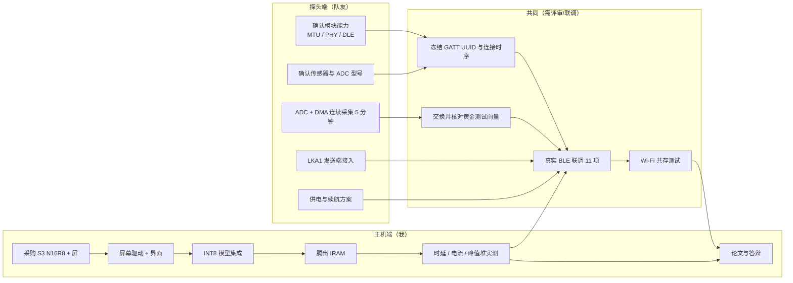

# 项目工作流与待办（2026-10-19）

> 两件事：① 跟队友确认什么；② 我接下来做什么。
> 图用 Mermaid，GitHub 上直接渲染。

## 1. 整体工作流



## 2. 剩余工作的分工泳道



## 3. 要跟队友确认的事（按阻塞程度排序）

| # | 确认项 | 为什么卡我 | 需要的交付物 | 阻塞级别 |
| --- | --- | --- | --- | --- |
| 1 | **实际 ATT MTU**（247？158？） | 不是 247 就要重算分片数、吞吐和缓冲；直接影响主机端重组代码 | 实测值 + 模块型号 | 🔴 高 |
| 2 | **是否加 `type=4 COMMAND`（START/STOP）** | 控制指令走 LKA1 还是独立特征，决定主机控制代码写一套还是两套 | 明确结论 | 🔴 高 |
| 3 | **模块射频能力**：128-bit 服务、2 特征、2M PHY、DLE 251 | 决定 GATT profile 能否落地 | datasheet 截图 / 实测 | 🔴 高 |
| 4 | **congestion 行为与错误码** | 决定 `Status.error_code=2` 能否上报；影响丢帧诊断 | 实测或厂商文档 | 🟡 中 |
| 5 | **Connection Parameter Update 接受度**（15 ms / latency 0） | 延迟预算和功耗都依赖它 | 实测 | 🟡 中 |
| 6 | **IO 能力（Just Works 还是 Passkey）** | 若只能 Just Works，安全方案要按 ADR-010 回退 | 明确 | 🟡 中 |
| 7 | **传感器 / 探头 MCU / ADC 型号** | 决定带宽、噪声底、电池与外壳 | 选型结论 | 🟡 中 |
| 8 | **8 kHz 采样时钟来源与精度**（ppm） | 时钟偏差会让两端缓冲漂移，影响 5 分钟连续流 | 晶振型号 / 实测 | 🟡 中 |
| 9 | **供电与续航目标**（单次时长、充电、目标续航） | 决定电池与充电芯片 | 数字目标 | 🟢 低 |
| 10 | **探头固件能否对上黄金向量**（CRC16、字节序） | 联调第一道关，越早越好 | 一份 `probe.lka` 样例 | 🟢 低 |

> 建议直接把 `docs/link-a-gatt-profile.md` §10 的文本发给队友，它就是按这 10 条写的。

## 4. 我今后的任务（按依赖排序）

| # | 任务 | 依赖 | 验收判据 | 预估 |
| --- | --- | --- | --- | --- |
| 1 | **采购 ESP32-S3-DevKitC-1 N16R8 + 320×240 SPI 屏** | 无 | 到货、能跑 `idf.py flash` | 1 天（等物流）|
| 2 | **腾 IRAM**：把非热路径放 flash、压缩缓冲、必要时用 PSRAM | 无 | `idf.py size` 后 IRAM < 95%，功能不减 | 2–3 天 |
| 3 | **屏幕驱动**（ST7789，SPI，320×240） | 1、2 | 波形 + `HR ~72` + 分数同屏刷新 ≥10 fps | 2–3 天 |
| 4 | **INT8 模型集成**（ESP-DL 或 TFLite Micro） | 1、2 | 板上输出与 PC ONNX 的 logit 差 < 1e-2；单窗 < 200 ms | 3–5 天 |
| 5 | **上板 11 项实测**（配合队友） | 3、4 + 队友 | 按 `link-a-gatt-profile.md` §9 逐条记录 | 2–3 天 |
| 6 | **电流与续航实测** | 5 | 平均电流、目标续航达成或记录差距 | 1 天 |
| 7 | **论文与答辩材料** | 5 | 结果表 + 决策对比页 + 失败分析页 | 3–5 天 |
| 8 | 可选：TCN 的 QAT | 无 | TCN INT8 掉点 ≤0.03 且体积可接受 | 1–2 周 |

## 5. 关键路径

```text
买板 → 腾 IRAM → 屏幕驱动 ┐
                          ├→ 上板 11 项 → 电流 → 论文
        INT8 模型集成 ────┘
队友：模块确认 → GATT 冻结 → 联调 ┘
```

**最短路径上的三个卡点**：

1. **IRAM 100% 占满**——不腾出来，屏幕和 AI 都加不进去；这是第一个必须解决的问题；
2. **队友的 MTU 实测值**——决定主机端重组与吞吐是否要改；
3. **`type=4 COMMAND` 的定夺**——一旦主机端控制代码写完再改，返工成本高。

## 6. 现在就能做的三件事

1. **今天下单**：ESP32-S3-DevKitC-1 N16R8 + 2.8" 320×240 SPI TFT（ADR-017）；
2. **今天发确认单**：把 §3 的 10 条（或 GATT 文档 §10）发给队友；
3. **不等板子**：先做 IRAM 腾挪的方案分析（读 map 文件、列出可移到 flash 的段），这一步不需要硬件。
